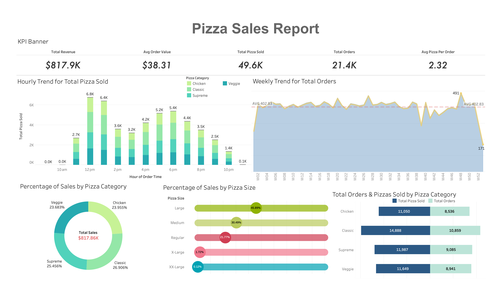

# 🍕 Pizza Sales Analysis | SQL & Tableau

An end-to-end data analytics project using **MySQL and Tableau** to analyze pizza sales performance, identify customer ordering patterns, and uncover business insights through SQL queries and interactive visualizations.

**Created by:** Vaibhav Borkar

## 📌 Project Overview

The objective of this project was to analyze pizza sales data and understand how the business performs across revenue, order volume, pizza categories, pizza sizes, and ordering patterns.

I used MySQL to cleanly structure and analyze the sales data, calculate key performance indicators (KPIs), and answer business questions. I then used Tableau to transform the results into a visual sales dashboard.

The project demonstrates how SQL and data visualization can work together to turn raw sales data into meaningful business insights.

## 🎯 Project Objectives

- Calculate key sales performance indicators.
- Analyze hourly and weekly order trends.
- Compare revenue contributions across pizza categories.
- Understand customer preferences for different pizza sizes.
- Identify top- and bottom-performing pizzas.
- Use SQL queries to answer practical business questions.
- Build a Tableau dashboard to communicate findings visually.

## 🛠️ Tools & Technologies

- **MySQL** — Data querying, aggregation, and analysis
- **MySQL Workbench** — SQL development and query execution
- **Tableau** — Dashboard development and data visualization
- **CSV** — Dataset storage and data import
- **SQL** — KPI calculations, grouping, filtering, sorting, and subqueries

## 📂 Dataset

The project uses a cleaned pizza sales dataset containing order-level and pizza-level sales information.

Key fields used in the analysis include:

| Column | Description |
|---|---|
| `order_id` | Identifier for each customer order |
| `order_date` | Date the order was placed |
| `order_time` | Time the order was placed |
| `pizza_name` | Name of the pizza |
| `pizza_category` | Category of the pizza |
| `pizza_size` | Size of the pizza |
| `quantity` | Number of pizzas sold |
| `total_price` | Sales value associated with the record |

The cleaned dataset was imported into MySQL and queried through the `sales_db.pizza_sales_clean` table.

## 📊 Key Performance Indicators (KPIs)

The SQL analysis produced the following results:

| KPI | Result |
|---|---:|
| Total Revenue | $817,860.05 |
| Average Order Value | $38.31 |
| Total Pizzas Sold | 49,574 |
| Total Orders | 21,350 |
| Average Pizzas per Order | 2.32 |

These KPIs provide an overview of sales performance and customer ordering behavior.

## 🔍 SQL Analysis

I wrote SQL queries to answer several business questions, including:

### 1. Overall Sales Performance

- What is the total revenue generated?
- What is the average order value?
- How many pizzas were sold?
- How many unique orders were placed?
- What is the average number of pizzas per order?

### 2. Ordering Trends

- Which days of the week generate the most orders?
- How does order volume change throughout the year?
- During which hours are the most pizzas sold?
- How does weekly order volume compare with the overall average?

### 3. Category and Size Analysis

- What percentage of revenue comes from each pizza category?
- Which pizza sizes contribute the most revenue?
- How do sales quantities differ across categories?
- Which category sold the most pizzas during February?

### 4. Product Performance

- Which five pizzas generate the highest revenue?
- Which five pizzas generate the lowest revenue?
- Which pizzas appear in the highest number of distinct orders?
- Which pizzas have the highest and lowest quantities sold?

The SQL queries use aggregation functions, `GROUP BY`, `ORDER BY`, `WHERE`, `COUNT(DISTINCT ...)`, subqueries, and `LIMIT` to extract relevant business insights.

## 📈 Tableau Dashboard

The Tableau dashboard combines key metrics and visualizations into a single sales report.

### Dashboard Preview



### Visualizations Included

**Hourly Trend for Total Pizza Sold**

A stacked bar chart showing hourly pizza sales across Chicken, Classic, Supreme, and Veggie categories.

**Weekly Trend for Total Orders**

An area chart showing weekly order fluctuations compared with the average weekly order volume.

**Percentage of Sales by Pizza Category**

A doughnut chart comparing the revenue contribution of each pizza category.

**Percentage of Sales by Pizza Size**

A visualization showing the percentage of revenue contributed by each pizza size.

**Total Orders and Pizzas Sold by Category**

A horizontal bar chart comparing order counts and quantities sold across pizza categories.

## 💡 Key Findings

### Sales Performance

- Total revenue reached approximately **$817.86K**.
- The business recorded **21,350 distinct orders**.
- Customers purchased **49,574 pizzas**, averaging approximately 2.32 pizzas per order.

### Ordering Patterns

- **Friday recorded the highest number of orders**, with 3,538 orders.
- Thursday followed with 3,239 orders, while Saturday recorded 3,158 orders.
- The hourly sales chart shows the strongest activity around lunchtime, particularly at noon and 1 PM, with another increase during the evening.

### Pizza Category Performance

The revenue contribution by category was:

| Category | Revenue | Share of Revenue |
|---|---:|---:|
| Classic | $220,053.10 | 26.91% |
| Supreme | $208,197.00 | 25.46% |
| Chicken | $195,919.50 | 23.96% |
| Veggie | $193,690.45 | 23.68% |

Classic pizzas contributed the largest share of total revenue among the four categories.

### Pizza Size Preferences

| Pizza Size | Revenue | Share of Revenue |
|---|---:|---:|
| Large | $375,318.70 | 45.89% |
| Medium | $249,382.25 | 30.49% |
| Small | $178,076.50 | 21.77% |
| X-Large | $14,076.00 | 1.72% |
| XX-Large | $1,006.60 | 0.12% |

Large pizzas accounted for nearly 46% of total revenue, making them the leading size by revenue contribution.

### Top-Performing Pizzas

The top five pizzas by revenue were:

1. The Thai Chicken Pizza — $43,434.25
2. The Barbecue Chicken Pizza — $42,768.00
3. The California Chicken Pizza — $41,409.50
4. The Classic Deluxe Pizza — $38,180.50
5. The Spicy Italian Pizza — $34,831.25

The Classic Deluxe Pizza recorded the highest number of distinct orders in the supplied query results, with 2,329 orders.

## 💼 Business Recommendations

Based on the analysis, several opportunities could be explored:

- **Staff scheduling:** Align staffing levels with higher-demand periods, especially around lunch and dinner.
- **Inventory planning:** Monitor ingredient requirements for popular pizzas and high-demand categories.
- **Product strategy:** Evaluate promotions and menu placement for high-performing pizzas.
- **Size-based promotions:** Explore bundle offers around large and medium pizzas, which contribute the majority of revenue.
- **Product improvement:** Investigate the reasons behind lower sales for bottom-performing pizzas before deciding whether to adjust pricing, marketing, or menu availability.
- **Performance monitoring:** Track revenue, order volume, and category performance regularly through the dashboard.

These recommendations are based on historical sales patterns and would benefit from further validation before implementation.

## 📁 Repository Structure

```text
pizza-sales-analysis-sql-tableau/
│
├── images/
│   ├── pizza-sales-dashboard.png
│   ├── hourly-pizza-sales.png
│   ├── weekly-order-trend.png
│   ├── sales-by-category.png
│   ├── sales-by-size.png
│   └── category-orders-and-quantity.png
│
├── data/
│   └── Pizza_Sales_clean.csv
│
├── sql/
│   └── pizza_sales_analysis.sql
│
└── README.md
```

## ▶️ How to Explore This Project

1. Clone or download the repository.
2. Open MySQL Workbench and connect to your MySQL server.
3. Create the `sales_db` database and import the cleaned CSV data into a table named `pizza_sales_clean`.
4. Open `sql/pizza_sales_analysis.sql` and run the queries.
5. Open the Tableau workbook or recreate the visualizations using the cleaned dataset and SQL results.
6. Explore the dashboard to review KPIs, order trends, category contributions, and pizza performance.

**Note:** The original SQL queries reference `sales_db.pizza_sales_clean`. Ensure that your database and table names match those references.

## 🚀 Future Improvements

- Add interactive Tableau filters for date, category, and pizza size.
- Analyze monthly revenue trends alongside monthly order counts.
- Compare revenue and quantity sold for individual pizzas.
- Investigate seasonal demand and customer ordering patterns.
- Build a more detailed profitability analysis if ingredient and operating cost data becomes available.

## 📚 What I Learned

This project helped me develop practical skills in SQL querying, data aggregation, KPI calculation, business analysis, and dashboard development.

It also strengthened my understanding of how to use MySQL to investigate business questions and Tableau to communicate findings through clear and meaningful visualizations.

## 👨‍💻 About Me

I'm Vaibhav Borkar, an aspiring data analyst interested in turning data into actionable business insights.

I'm continuously building my skills in SQL, Python, data visualization, and analytics through hands-on projects.

---

**Thank you for exploring my project!**

Feel free to review the SQL queries, explore the dashboard, and share any feedback or suggestions.
